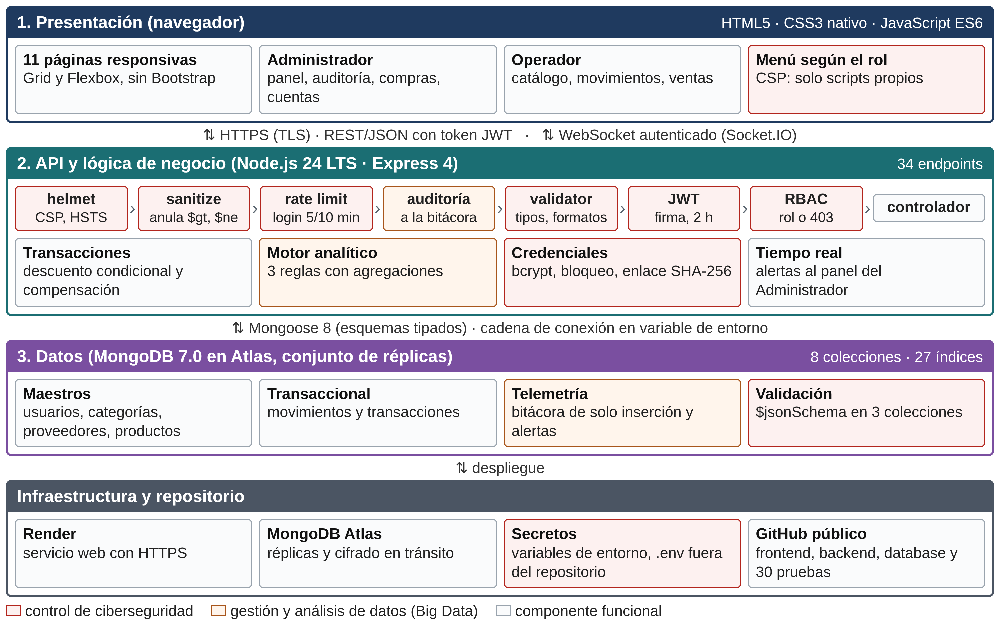

# DataSecure Stock

Plataforma web de gestión inteligente de inventario y seguridad de datos para **TecnoSur SpA**.
Proyecto de Título - Escuela de Informática y Telecomunicaciones.

La solución integra la operación de bodega y de venta con una capa analítica de ciberseguridad:
toda acción sobre el sistema queda registrada en una colección append-only y un motor
de reglas evalúa esos datos para levantar alertas en tiempo real hacia el panel del
administrador.

**Sistema publicado:** https://datasecure-stock.onrender.com (plan gratuito de Render: la primera carga después de un rato sin uso puede tardar cerca de un minuto).

## Avance semana 4: modelo de datos y arquitectura

| Documento | Contenido |
|-----------|-----------|
| [`docs/modelo-datos.png`](docs/modelo-datos.png) | Esquema documental refinado: 8 colecciones, referencias, índices y validación |
| [`docs/arquitectura.png`](docs/arquitectura.png) | Arquitectura por capas con los controles de ciberseguridad y el flujo analítico |
| [`database/indices.js`](database/indices.js) | 19 índices secundarios y validación `$jsonSchema` aplicados en el motor |
| [`database/export/`](database/export) | Exportación JSON de las 8 colecciones con los datos de demostración |
| [`tests/resultado_pruebas.json`](tests/resultado_pruebas.json) | Resultado de los 30 casos funcionales y de seguridad (30 de 30 aprobados) |



### Dónde ver Big Data en el código

- `backend/models/LogOperativo.js`: colección `logs_operativos`, de solo inserción, con índices por fecha, IP y usuario.
- `backend/middlewares/auditoria.js`: registra un evento por cada petición que modifica estado o intenta autenticarse.
- `backend/utils/motorAnalitico.js`: tres reglas resueltas con *aggregation pipeline* dentro de MongoDB (fuerza bruta, acceso fuera de perfil y retiro masivo) e indicadores del panel calculados con agregaciones.
- `database/export/_resumen.json`: la bitácora reúne 993 de los 1.248 documentos de demostración.

### Dónde ver ciberseguridad en el código

- `backend/app.js`: cadena de middlewares (helmet con CSP y HSTS, CORS, límite de 100 kb, sanitización de operadores, límite de peticiones y auditoría).
- `backend/middlewares/autenticacion.js`: verificación de JWT (emisor y vencimiento) y control de acceso por rol.
- `backend/middlewares/limitador.js`: límites global, de inicio de sesión y de recuperación de credenciales.
- `backend/controllers/authController.js`: bcrypt, bloqueo tras cinco intentos fallidos y enlace de recuperación guardado como hash SHA-256.
- `backend/routes/index.js`: validación de cada campo con express-validator antes del controlador.
- `.env.example`: plantilla sin secretos; el archivo `.env` real está excluido en `.gitignore`.

---

## 1. Requisitos

| Componente | Versión mínima |
|------------|----------------|
| Node.js    | 20 LTS         |
| MongoDB    | 7.0            |
| Navegador  | Chrome / Edge / Firefox actualizado |

## 2. Puesta en marcha

```bash
npm install
cp .env.example .env          # completar MONGO_URI y JWT_SECRET
npm run seed                  # carga catálogo, ventas, compras y telemetría de ejemplo
npm start                     # http://localhost:3000
```

## 3. Cuentas de demostración (creadas por el seed)

| Perfil        | Correo                  | Contraseña          |
|---------------|-------------------------|---------------------|
| Administrador | admin@tecnosur.cl       | Admin2026#Seguro    |
| Operador      | operador@tecnosur.cl    | Operador2026#Bod    |
| Operador      | bodega2@tecnosur.cl     | Bodega2026#Sur      |

Son cuentas de demostración con datos ficticios. Cambiar estas contraseñas antes de usar el sistema con datos reales.

## 4. Estructura

```
DataSecure-Stock/
├── backend/
│   ├── app.js              construcción de Express y cadena de middlewares
│   ├── server.js           arranque HTTP + canal Socket.IO autenticado
│   ├── seed.js             carga inicial de datos
│   ├── config/db.js        conexión única a MongoDB
│   ├── models/             8 esquemas Mongoose (una colección cada uno)
│   ├── controllers/        lógica de negocio por módulo
│   ├── middlewares/        JWT, RBAC, auditoría, límites, errores
│   ├── routes/index.js     definición y validación de todos los endpoints
│   └── utils/              motor analítico, servicio de transacciones y correo
├── frontend/               HTML5 + CSS3 nativo + JavaScript ES6 (sin frameworks)
├── database/               diccionario de datos, índices y exportación JSON
└── tests/pruebas.js        suite de 30 casos funcionales y de seguridad
```

## 5. Perfiles y permisos

| Recurso                      | Administrador | Operador     |
|------------------------------|---------------|--------------|
| Catálogo de productos        | CRUD completo | Solo lectura |
| Proveedores y categorías     | CRUD completo | Solo lectura |
| Movimientos de stock         | Registrar y consultar | Registrar y consultar |
| Carro: venta                 | Registrar y consultar | Registrar y consultar las propias |
| Carro: compra a proveedor    | Registrar y consultar | Sin acceso   |
| Reactivar un producto        | Sí            | No           |
| Cuentas de usuario           | CRUD completo | Sin acceso   |
| Auditoría y alertas          | Consulta y cierre | Sin acceso |
| Panel de análisis            | Acceso        | Sin acceso   |

## 6. Medidas de ciberseguridad implementadas

1. Contraseñas cifradas con **bcrypt** (factor de costo 10); el hash nunca sale por la API.
2. Autenticación **JWT** firmada, con emisor y vencimiento, verificada en cada petición.
3. **RBAC** por ruta con principio de mínimo privilegio.
4. **Sanitización** de operadores de MongoDB para neutralizar inyección NoSQL.
5. **Validación** de todos los campos de entrada con express-validator; un valor que no es
   texto se rechaza sin convertirlo y la búsqueda trata lo escrito como literal.
6. **Rate limiting** diferenciado: global, de acceso y de recuperación de credenciales.
7. Bloqueo temporal de la cuenta tras cinco intentos fallidos consecutivos.
8. Cabeceras de seguridad con **Helmet** (CSP, HSTS, sin X-Powered-By).
9. Auditoría **append-only** de toda acción que modifica estado.
10. Enlace de recuperación de un solo uso, almacenado como hash SHA-256 y con vencimiento.

## 7. Carro de compra y venta

- **Venta** (Administrador y Operador): se agregan artículos desde el catálogo o desde la
  pantalla del carro, se ajustan cantidades y se confirma. El servidor fija el precio desde
  el catálogo (el que envíe el navegador se ignora), descuenta el stock de todas las líneas
  y emite un comprobante con folio correlativo (V-000001), neto, IVA 19 % y total.
- **Compra a proveedor** (solo Administrador): suma stock con el costo unitario de la
  factura del proveedor y emite el comprobante C-000001.
- **Todo o nada**: si una línea no tiene stock suficiente, ninguna existencia cambia. La
  condición de stock viaja dentro de la actualización; si otra venta toma las unidades en el
  mismo instante, se revierten las líneas ya aplicadas.
- **Trazabilidad**: cada línea genera su movimiento con la referencia del folio; la
  operación queda en la bitácora, el motor analítico la considera en la regla de retiro
  masivo, el panel muestra ventas y compras de las últimas 24 horas y los más vendidos, y
  las demás sesiones reciben el aviso en tiempo real.
- **Estados del producto**: Normal, Bajo mínimo, Sin stock e Inactivo. Un producto dado de
  baja no se vende ni se compra hasta que el Administrador lo reactive.
- El comprobante es un documento interno de control de inventario: no reemplaza la boleta
  ni la factura electrónica.

## 8. Pruebas

```bash
npm test
```

Levanta una instancia real de MongoDB, la puebla y ejecuta los 30 casos del plan de
pruebas contra la API por HTTP. Deja el detalle en `tests/resultado_pruebas.json`.

## 9. Despliegue

1. Aprovisionar el servicio de base de datos (MongoDB Atlas con Replica Set) y obtener la cadena de conexión.
2. Crear la aplicación en el proveedor de hosting con Node.js 20 y definir las variables del archivo `.env`.
3. Publicar el código, ejecutar `npm ci --omit=dev` y `npm run seed` la primera vez.
4. Habilitar HTTPS. En el avance publicado lo gestiona Render; en un servidor propio, usar certificado TLS y Nginx como proxy inverso hacia el puerto de la aplicación.
5. Restringir el acceso a la base de datos por lista de direcciones IP y crear un usuario con privilegios acotados a la base del proyecto.
